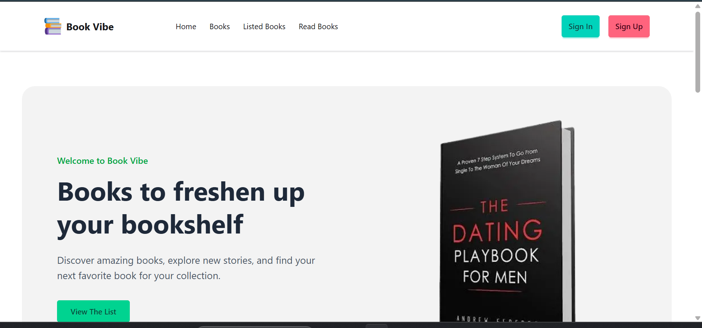

# 📚 Book Vibe

### Discover Books. Build Your Reading Journey.

**Book Vibe** is a modern and responsive book library web application that helps users explore books, discover detailed information, organize their reading lists, and maintain a personal wishlist.

Built with Next.js, React, TypeScript, Tailwind CSS, and DaisyUI, Book Vibe provides a clean and user-friendly experience for book lovers.

🌐 **Live Website:** [Book Vibe](https://bookvibe-sigma.vercel.app/)

---

## 📸 Project Screenshot

<!-- Add your project screenshot to the public folder using the filename below. -->

<p align="center">
  
</p>

<p align="center">
  <em>Book Vibe — Your personal space to discover and organize books.</em>
</p>

> **How to add the screenshot:** Save your homepage screenshot as `book-vibe-preview.png` inside the `public` folder. The image will appear here when you push the file to GitHub.

---

## ✨ Features

- 📚 **Browse Books** — Explore the available book collection.
- 🔍 **Book Details** — View detailed information about individual books.
- ⭐ **Book Ratings** — See book ratings and reviews when available.
- 📝 **Book Reviews** — Read available reviews and descriptions.
- 📖 **Reading List** — Add books to your reading list.
- ❤️ **Personal Wishlist** — Save books you want to read later.
- 📊 **Reading Statistics** — View reading progress and statistics.
- 🔄 **Book Sorting** — Sort books using available sorting options.
- 📱 **Responsive Design** — Optimized for mobile, tablet, and desktop.
- 🎨 **Modern UI** — Styled with Tailwind CSS and DaisyUI.
- ⚡ **Next.js Performance** — Built using the Next.js framework.

---

## 🛠️ Technology Stack

| Technology | Purpose |
|---|---|
| Next.js | React framework and application routing |
| React | Interactive user interfaces |
| TypeScript | Type safety and maintainable code |
| Tailwind CSS | Utility-first styling |
| DaisyUI | Prebuilt UI components |
| React Icons | Icons and visual elements |
| Recharts | Charts and reading statistics |
| React Context API | Shared application state, if used |
| Vercel | Deployment and hosting |
| Git & GitHub | Version control and source code management |

> Keep only the technologies actually used in your project.

---

## 📦 Dependencies

Book Vibe uses npm to manage its packages.

### Main Dependencies

The following packages may be part of the project, depending on your implementation.

| Package | Purpose |
|---|---|
| `next` | Next.js framework |
| `react` | UI library |
| `react-dom` | React DOM rendering |
| `typescript` | TypeScript support |
| `tailwindcss` | Styling and responsive design |
| `daisyui` | UI component library |
| `react-icons` | Icon library |
| `recharts` | Charts and data visualization |

### Install Dependencies

Run the following command from the project directory:

```bash
npm install
```

> **Note:** Verify your actual dependencies and package versions in `package.json`. Remove any package that your project does not use.

---

## 📂 Project Structure

The following is an illustrative project structure based on the files you provided. Update it if your actual folders differ.

```text
book-vibe/
├── public/
│   ├── booksData.json
│   ├── book1.png
│   ├── hero_img.jpg
│   ├── favicon.jpg
│   └── book-vibe-preview.png
│
├── src/
│   ├── app/
│   │   ├── page.tsx
│   │   ├── books/
│   │   ├── books/[id]/
│   │   ├── listedBooks/
│   │   ├── read-books/
│   │   ├── layout.tsx
│   │   └── globals.css
│   │
│   ├── components/
│   ├── contexts/
│   ├── type/
│   └── ...
│
├── .gitignore
├── package.json
├── package-lock.json
├── tsconfig.json
├── next.config.ts
└── README.md
```

> This structure is illustrative. Keep your actual directory and file names in the final README.

---

## 🚀 Getting Started

Follow these instructions to run Book Vibe locally.

### Prerequisites

Make sure you have installed:

- [Node.js](https://nodejs.org/)
- npm
- [Git](https://git-scm.com/)

### 1. Clone the Repository

Replace `YOUR_GITHUB_REPOSITORY_URL` with your actual GitHub repository URL.

```bash
git clone YOUR_GITHUB_REPOSITORY_URL
```

### 2. Navigate to the Project Directory

```bash
cd book-vibe
```

### 3. Install Dependencies

```bash
npm install
```

### 4. Start the Development Server

```bash
npm run dev
```

### 5. Open the Application

Visit the following URL in your browser:

```text
http://localhost:3000
```

The application should now be running locally.

---

## 📖 Main Pages

| Page | Description |
|---|---|
| Home | Explore the available book collection |
| Books | Browse the book library |
| Book Details | View information about an individual book |
| Listed Books | Manage reading lists and wishlist |
| Pages to Read | View reading progress and statistics |

> These routes are based on the project structure you described. Adjust them to match your actual routes.

---

## 📊 Reading Progress

Book Vibe includes reading-related features to help users organize their book collection and track their reading journey.

Depending on the current implementation, users can:

- Organize books in their reading list.
- Maintain a wishlist of books.
- View reading statistics.
- Explore sorting options for listed books.

---

## 📱 Responsive Design

Book Vibe is designed to work across different screen sizes:

- 📱 Mobile phones
- 📲 Tablets
- 💻 Laptops
- 🖥️ Desktop computers

---

## 🏗️ Production Build

To create a production build, run:

```bash
npm run build
```

To start the production server after a successful build:

```bash
npm start
```

---

## 🚀 Deployment

Book Vibe is deployed on Vercel.

🌐 **Live Demo:** [https://bookvibe-sigma.vercel.app/](https://bookvibe-sigma.vercel.app/)

To deploy your own version:

1. Push the project to GitHub.
2. Import the repository into Vercel.
3. Configure any required environment variables.
4. Deploy the application.
5. Verify the live website.

---

## 🎯 Project Purpose

The primary goal of Book Vibe is to build a clean, responsive, and user-friendly book management application while practicing modern web development technologies.

This project demonstrates practical experience with:

- Next.js and React.
- TypeScript.
- Tailwind CSS and DaisyUI.
- Component-based UI development.
- Application state management.
- Book listing and detail pages.
- Reading lists and wishlists.
- Responsive web design.

---

## 👨‍💻 Developer

**Md Asif Ali**

Full-Stack Web Developer | Computer Science & Engineering Student

### Skills

JavaScript · TypeScript · React.js · Next.js · Tailwind CSS · Node.js · Express.js · MongoDB

### Connect With Me

- **GitHub:** [@asifdev62](https://github.com/asifdev62)
- **Live Project:** [Book Vibe](https://bookvibe-sigma.vercel.app/)

---

## 📄 License

This project is created for educational and portfolio purposes.

If you want others to reuse, modify, or distribute the code under specific terms, add an appropriate `LICENSE` file to the repository.

---

<p align="center">
  <strong>📚 Book Vibe — Read More. Discover More.</strong>
</p>

<p align="center">
  Made with ❤️ by Md Asif Ali
</p>
